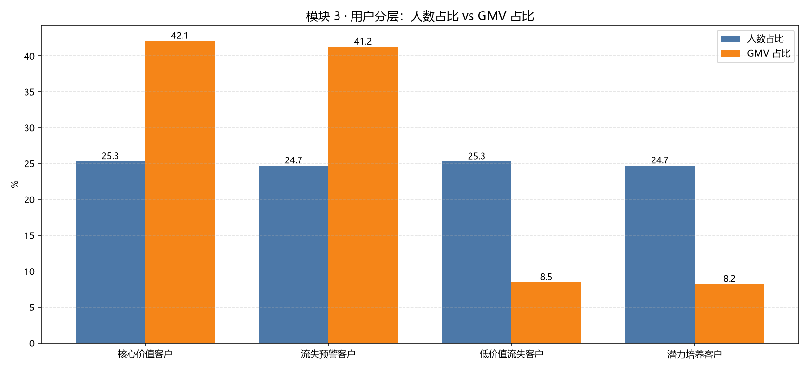

# Olist 电商平台经营诊断与用户增长分析

> 用 9.6 万笔真实电商订单，回答三个业务问题：**增长从哪来、钱花在哪、体验值不值得投入。**
>
> **技术栈**：SQL（SQLite）· Python（pandas / SciPy / matplotlib）· Power BI
> **数据规模**：9 张表、1,550,922 行 → 清洗后 **96,211 笔订单 / 93,104 位用户**
> **数据来源**：[Brazilian E-Commerce Public Dataset by Olist](https://www.kaggle.com/datasets/olistbr/brazilian-ecommerce)（公开脱敏数据）


---

## 一句话结论

GMV 在 20 个月里涨了 **7.5 倍**，但增长 **100% 来自新客**——客单价反而跌了 **11%**，老客只贡献 **1.5%** 的 GMV；
而配送超时会让订单评分掉 **1.73 分**（Welch t = -89.4，Cohen's d = **1.45**），差评率是准时订单的 **5.9 倍**。

---

## 五个核心发现

| # | 发现 | 关键数字 |
| --- | --- | --- |
| 1 | **增长靠拉新，单客价值在下降** | GMV ×7.5 ≈ 人数 ×8.8 × 人均单数 ×0.96 × 客单价 ×0.89；老客 GMV 占比仅 **1.5%** |
| 2 | **业务高度集中** | 74 个品类中前 18 个（24%）贡献 **80%** 销售额；**SP 一个州占 38.4%**，前 3 州占 63.4% |
| 3 | **履约健康但丢单成本不低** | 97.1% 走到签收；未完成的 2.9% 造成 **36.07 万**销售额损失；运费占 GMV **16.6%** |
| 4 | **留存是最大短板** | 次月留存率 **0.45%**、90 天复购率 **1.28%**；但 3% 的复购用户人均消费是其他人的 **1.88 倍** |
| 5 | **超时是体验头号杀手** | 准时 4.29 分 vs 超时 2.57 分（差 1.73）；差评率 9.2% vs **54.0%**；跨 23 个州 r = **-0.861** |



---

## 三个看板页面

| 页面 | 回答什么 |
| --- | --- |
| **总览** | 生意在怎么长？新客还是老客在撑？集中在哪？ |
| **用户** | 谁在贡献钱？留存有多差？ |
| **体验** | 超时对评分的影响有多大？ |

### 用户页


### 体验页


> 交互式看板源文件：`电商分析看板.pbix`（用 Power BI Desktop 打开）

---

## 数据与方法

### 清洗（12 类数据质量问题）

| 处理 | 说明 |
| --- | --- |
| 订单筛选 | 只保留 `delivered` 且下单时间在 2017-01-01 ~ 2018-09-01（99,441 → **96,211**） |
| 用户口径 | 一律用 `customer_unique_id`（订单级编号会把同一个人重复计数） |
| 一单多评 | 取评价时间最新的一条（96,095 → 95,568） |
| 地理表 | 先按邮编聚合（100 万行 → 19,010 行），避免连表后行数爆炸 |

> 完整清单见 [`数据问题清单.md`](数据问题清单.md)。其中两条关键判断：
> **① 2,965 个空白签收时间里 2,957 个是"未送达"的正常缺失**，不能一刀切删除；
> **② 经纬度大量为负是正常的**（巴西在南半球西半球），只有 60 多条超出巴西范围才是错误。

### 分析方法

| 方法 | 用在哪 |
| --- | --- |
| 指标拆解（GMV = 人数 × 人均单数 × 客单价） | 增长诊断 |
| 帕累托 / ABC 分析 | 品类结构 |
| RFM 适配版（R×M + 复购标记） | 用户分层（本数据 97% 只买 1 次，标准 RFM 的 F 维度失真） |
| 同期群（Cohort）留存 | 留存分析（固定 90 天观察窗，避免新群观察期不足） |
| **卡方检验** | 首单体验 → 90 天复购 |
| **Welch t 检验 + 曼-惠特尼 U 检验** | 超时 vs 评分（前者比均值，后者不假设正态） |
| **Cohen's d 效应量** | 判断差异"有多大"，而不只是"显不显著" |

### 双实现交叉验证

同一套清洗逻辑用 **pandas** 和 **SQL** 各实现一遍，关键指标逐项比对：

| 指标 | pandas | SQL | 一致 |
| --- | --- | --- | --- |
| 有效订单数 | 96,211 | 96,211 | ✅ |
| 订单明细行数 | 109,880 | 109,880 | ✅ |
| GMV | 13,181,027.13 | 13,181,027.13 | ✅ |
| 评价去重后 | 95,568 | 95,568 | ✅ |

> 交叉验证抓出了一个真实错误：早期文档里"总行数"写成 1,633,478，实际 **1,550,922**，已全部修正。

---

## 三条建议（摘自完整报告）

| 建议 | 依据 | 预期效果 |
| --- | --- | --- |
| **把首单超时率 / 首单差评率做成硬指标**，首单订单优先配运力 | 首单差评用户 90 天复购率低 33%（p=0.0087） | 首单差评率每降 1pp，约多留住 1,000 个潜在复购客户 |
| **召回 2.3 万"流失预警客户"**（高消费 + 久未购买） | 这群人贡献 41% GMV、人均消费 236 元 | 召回率 5% 约新增 2.7 万元 GMV |
| **把复购率纳入北极星指标**，不只看 GMV | 复购率仅 3%，复购用户人均价值 1.88 倍 | 复购率 3% → 5%，GMV 约增 4% |

---

## 项目结构

```
我的电商分析项目/
├── README.md                  ← 本文件（项目总览）
├── 分析报告.md                ← 完整分析报告（6 个发现 + 5 条建议 + 局限）
├── 操作手册.md                ← 每一步怎么跑、怎么复现
├── 数据问题清单.md            ← 12 类数据质量问题与处理
├── 指标体系.md                ← 指标树、口径、常见陷阱
├── 项目日志.md                ← 每日进展 / 决策 / 踩过的坑
├── GitHub上传步骤.md
├── requirements.txt
│
├── sql/                       ← SQL 版清洗（5 个文件，从筛订单到建索引）
├── figures/                   ← 图表
├── 电商分析看板.pbix          ← Power BI 看板（3 页 26 个视觉对象）
│
├── 01_数据体检.py             ← 扫描 155 万行，输出数据质量问题
├── 02_monthly_orders.py       ← 月度订单量（确认分析时间窗）
├── 03_clean.py                ← 清洗（pandas 版，10 项校验）
├── 04_build_db.py             ← 建库 + SQL 清洗 + 与 pandas 交叉验证
├── 05_metrics.py              ← 指标体系（20 个月 × 14 个指标）
├── 06_overview.py             ← 模块 1 经营诊断
├── 07_funnel.py               ← 模块 2 履约漏斗 + 支付行为
├── 08_rfm.py                  ← 模块 3 用户价值分层
├── 09_cohort.py               ← 模块 4 同期群留存（含卡方检验）
├── 10_experience.py           ← 模块 5 体验归因（t 检验 + 效应量）
└── 11_prepare_dashboard.py    ← 生成 Power BI 用的数据
```

> 原始数据、清洗中间结果、数据库（约 400 MB）**不在仓库里**，用 `.gitignore` 排除；按下面「怎么复现」重新生成即可。

---

## 怎么复现

```bash
# 1. 安装依赖
pip install -r requirements.txt

# 2. 从 Kaggle 下载 9 个 CSV，放到 原始文件\ 文件夹
#    https://www.kaggle.com/datasets/olistbr/brazilian-ecommerce

# 3. 依次运行（或双击对应的 .bat）
python 01_数据体检.py      # 数据体检
python 02_monthly_orders.py # 确认时间窗
python 03_clean.py         # 清洗（10 项校验）
python 04_build_db.py      # SQL 清洗 + 交叉验证（17 项校验）
python 05_metrics.py       # 指标体系
python 06_overview.py      # 模块 1
python 07_funnel.py        # 模块 2
python 08_rfm.py           # 模块 3
python 09_cohort.py        # 模块 4
python 10_experience.py    # 模块 5
python 11_prepare_dashboard.py  # 生成看板数据
```

每一步都会打印校验数字（例如清洗后订单数应为 **96,211**），对不上说明数据或口径有问题。

---

## 局限

1. **没有流量数据**：数据集没有浏览 / 加购埋点，做不了"访问 → 加购 → 下单"的转化漏斗，只能用履约链路近似。
2. **相关不等于因果**：所有检验只证明"超时订单评分更差"这个**关联**真实存在，不能证明"超时导致差评"——可能存在第三因素。要证明因果需要 A/B 测试或断点回归。
3. **时间窗口 2017–2018**：结论不能直接外推到当前市场。
4. **没有成本数据**：算不出毛利和真实 ROI。

---

## 文件导览

| 想看什么 | 去哪个文件 |
| --- | --- |
| 完整的业务结论和建议 | [`分析报告.md`](分析报告.md) |
| 数据质量怎么处理的 | [`数据问题清单.md`](数据问题清单.md) |
| 指标怎么定义的 | [`指标体系.md`](指标体系.md) |
| 每一步怎么跑、怎么验证 | [`操作手册.md`](操作手册.md) |
| 项目是怎么一步步做出来的 | [`项目日志.md`](项目日志.md) |
